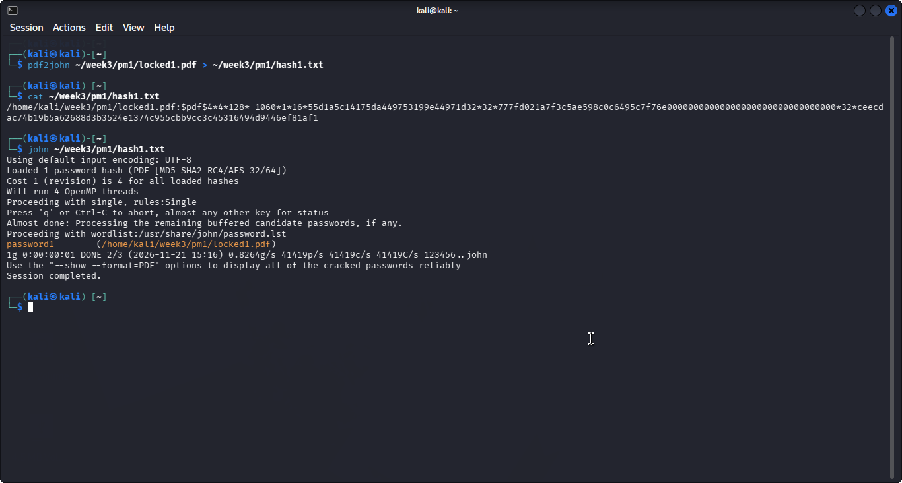
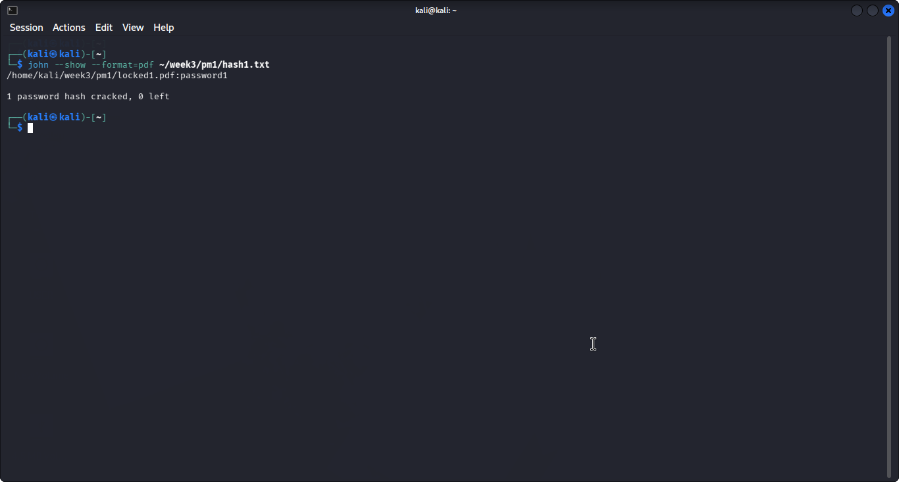
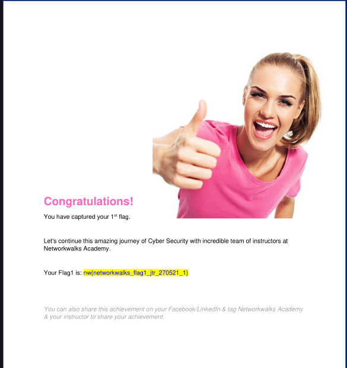
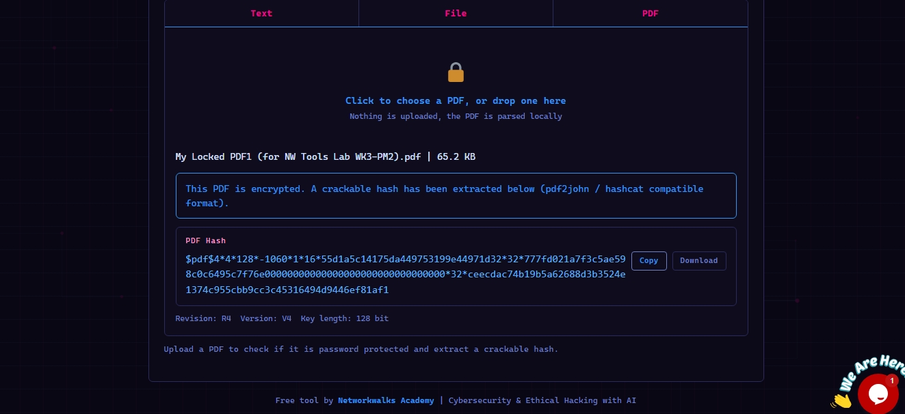
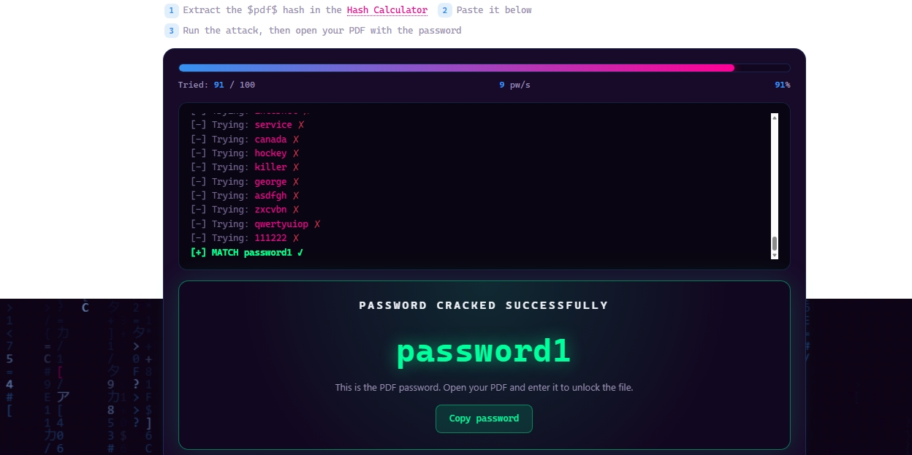
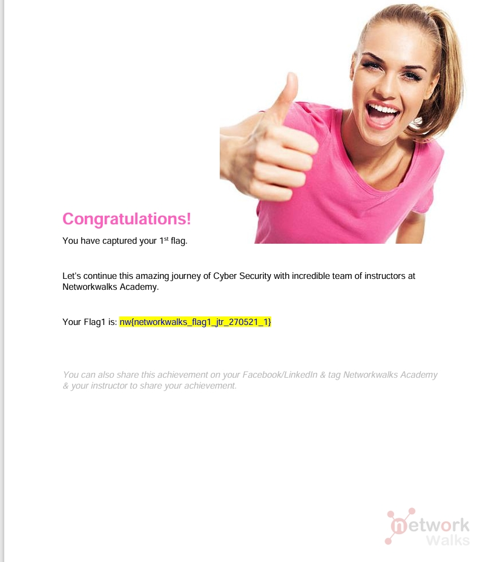

# Week 3: Password Cracking (Cybersecurity Internship)

## Objective
Complete both essential modules for Week 3 of the Networkwalks Cybersecurity Internship: password cracking with John the Ripper (W3-PM1) and password cracking with Networkwalks' browser-based tools (W3-PM2).

## What I did
- Extracted a crackable hash from a locked PDF using pdf2john on Kali Linux, then cracked it with John the Ripper in under a second
- Repeated the same recovery using Networkwalks' free browser-based Hash Calculator and Password Cracker, with no installation required
- Both methods independently recovered the same password and unlocked the same flag

## Commands used (W3-PM1)
```bash
pdf2john ~/week3/pm1/locked1.pdf > ~/week3/pm1/hash1.txt
john ~/week3/pm1/hash1.txt
john --show --format=pdf ~/week3/pm1/hash1.txt
```

## Screenshots


*pdf2john extraction followed by John the Ripper cracking the password in under a second.*


*Confirming the cracked password with john --show.*


*The unlocked PDF, confirming the password and showing the captured flag.*


*Networkwalks Hash Calculator extracting the same hash from the PDF, no installation required.*


*Networkwalks Password Cracker finding the match after trying 91 of 100 candidate passwords.*


*Flag confirmation after unlocking the PDF with the password found via the Networkwalks tools.*

## Full report
See [W3-PM-FINAL-Report-Ibrahim-Jalloh.docx](W3-PM-FINAL-Report-Ibrahim-Jalloh.docx) for the complete penetration testing report.

## Modules completed
| Module | Status |
|---|---|
| W3-PM1 (John the Ripper) | Done |
| W3-PM2 (Networkwalks tools) | Done |
| Optional modules (AI-assisted JTR, Mediroza Hospital) | Not attempted; may revisit |

## Environment
Kali Linux (live USB, persistence enabled) for W3-PM1, due to hardware virtualization being locked in my laptop's BIOS. Windows laptop (browser only) for W3-PM2.

## Scope note
Both activities targeted only the lab-provided password-protected PDF file supplied for this exercise. No systems, files, or accounts outside this lab file were accessed or tested.
